<p align="center">
  
</p>

<h1 align="center">Taskfern — Open-Source Android To-Do List, Daily Planner &amp; Reminders</h1>

<p align="center">
  <strong>A beautiful, offline-first Android task manager with recurring reminders, shopping lists, routines, calendar planning, and interactive Material 3 widgets.</strong>
</p>

<p align="center">
  <a href="https://github.com/riyadmondol2006/Taskfern/releases/latest"></a>
  <a href="https://github.com/riyadmondol2006/Taskfern/actions/workflows/release.yml"></a>
  <a href="LICENSE"></a>
  
  
</p>

<p align="center">
  <a href="https://github.com/riyadmondol2006/Taskfern/releases/latest"><strong>⬇ Download the latest APK</strong></a>
</p>

Taskfern is a **free Android task manager** and **daily planner** that keeps everything on your phone. Plan your day
on a calm Today dashboard, add tasks in a couple of taps, get **reliable reminders**, repeat tasks the way you
actually need, tick off groceries one-handed, follow daily routines and check things off right from your **home-screen
widgets**. It is an **open-source Android productivity app** built with Kotlin and Jetpack Compose — no account,
no ads, no trackers and no internet permission.

<p align="center">
  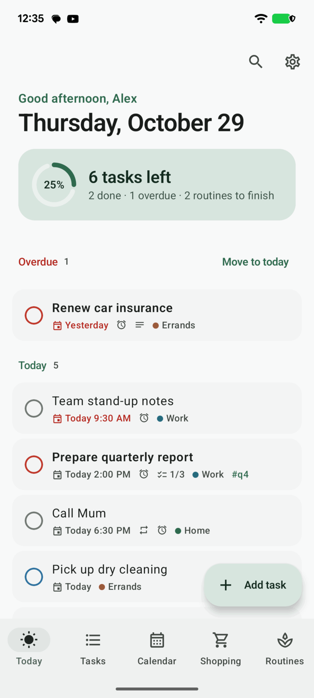
  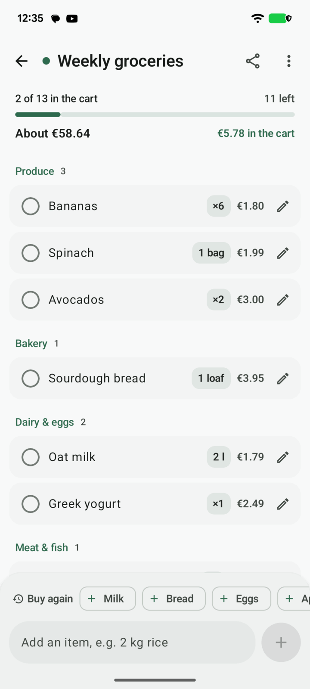
  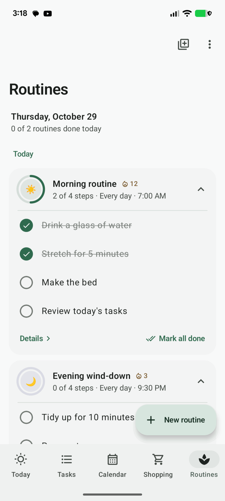
  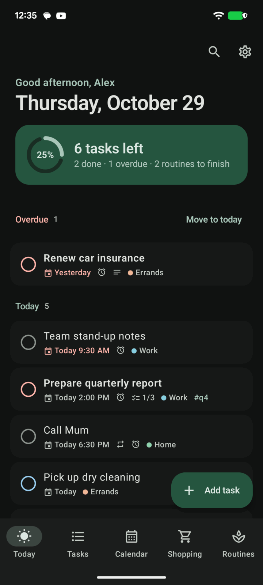
</p>

## Contents

[Features](#features) · [Screenshots](#screenshots) · [Widgets](#interactive-home-screen-widgets) ·
[Install](#installation) · [Update](#updating-the-app) · [Build](#building-from-source) ·
[Architecture](#project-architecture) · [Releases](#github-actions-and-releases) · [Backup](#backup-and-restore) ·
[FAQ](#faq) · [Troubleshooting](#troubleshooting) · [Contributing](#contributing) · [License](#license)

## Features

- **Today dashboard** — greeting, date, progress ring, overdue and due-today tasks, today's routines, upcoming
  reminders and important tasks, with one-tap “Move to today” for everything overdue.
- **Fast capture** — the Quick Add sheet opens with the keyboard ready, stays open for the next task and recognises
  “tomorrow 6pm”, “friday”, “in 3 days”, `!!` and `#tags` locally, showing what it understood before saving.
- **Full to-do list management** — lists, priorities, tags, notes, checklists, pinning, duplicate, archive, Recently
  deleted with restore, multi-select bulk actions, search, sorting, filters and manual ordering.
- **Smart views** — Inbox, Today, Tomorrow, This week, Upcoming, Overdue, Important, No due date, Recently created,
  Completed and All tasks.
- **Recurring tasks for Android done right** — daily, weekdays, chosen weekdays, weekly, monthly, yearly, every N
  days/weeks/months/years, **repeat after completion**, end on a date or after N times, pause, resume and skip.
- **Reminders that respect Android** — several reminders per task, snooze, complete or move to tomorrow from the
  notification, recovery after restarts and time-zone changes, an optional daily agenda.
- **Android shopping list** — grocery aisles, quantities and units, suggestions, buy again, duplicate detection,
  optional prices and totals, templates and sharing as plain text.
- **Daily routine planner** — reusable checklists with weekdays, an optional reminder time, progress and history.
- **Calendar** — month and week views, due-task dots, projected repeats, quick rescheduling.
- **Five interactive Android home-screen widgets** — Today's tasks, Quick Add, Shopping list, Weekly agenda and Daily
  routine.
- **Material You to-do app** — dynamic colour, light, dark and AMOLED black themes, five accent palettes.
- **Offline task manager** — JSON backup and restore (merge or replace), calendar (.ics) export, focus timer and
  quiet insights. Everything works without a connection.

## Screenshots

All screenshots are real captures from a Google Pixel 6 running Android 17, using fictional demo data.

| Today | Tasks | List | Upcoming |
| :---: | :---: | :---: | :---: |
|  | 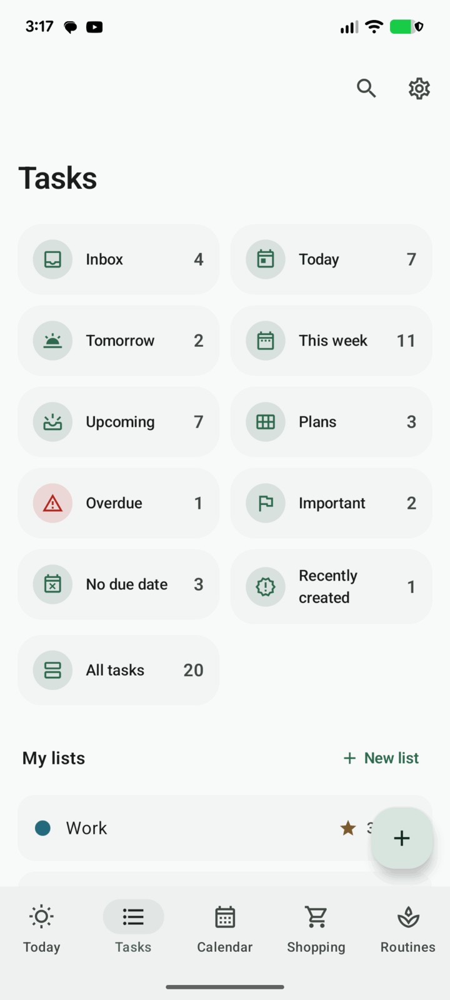 | 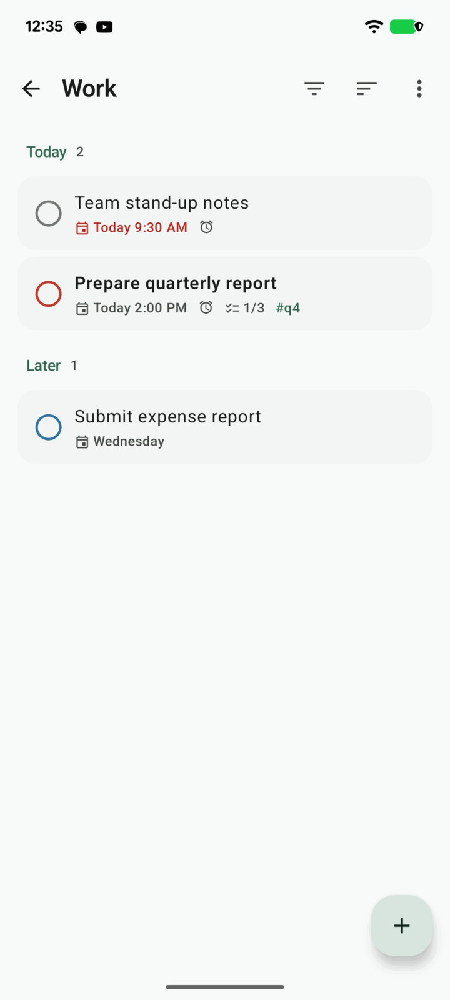 | 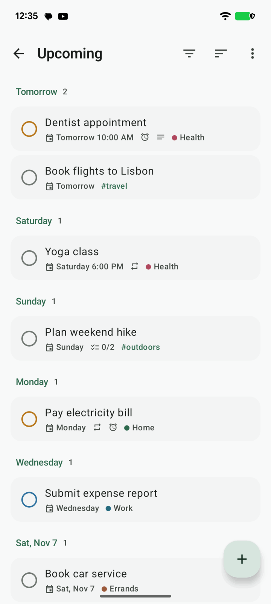 |
| **Task details** | **Repeat rule** | **Quick Add** | **Calendar** |
| 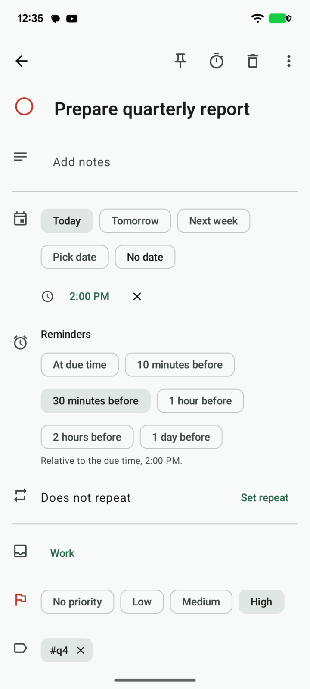 | 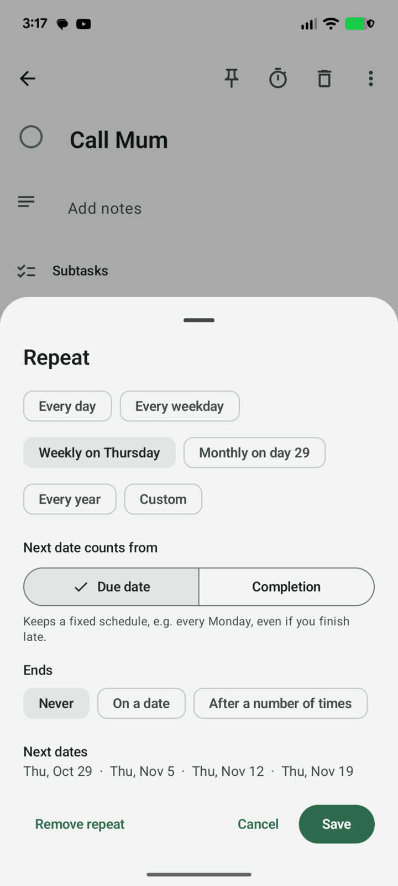 | 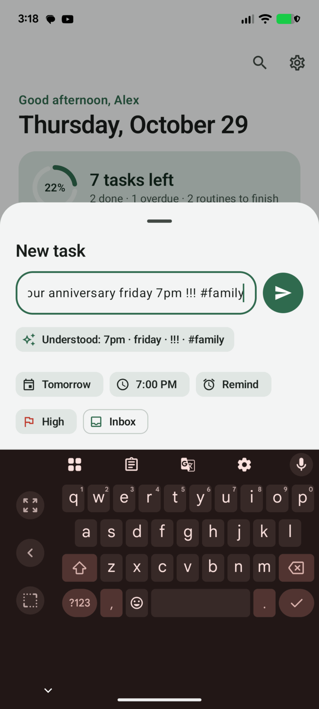 | 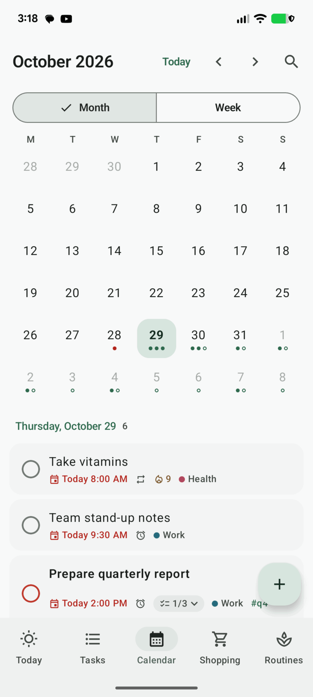 |
| **Shopping** | **Routines** | **Routine history** | **Settings** |
|  |  | 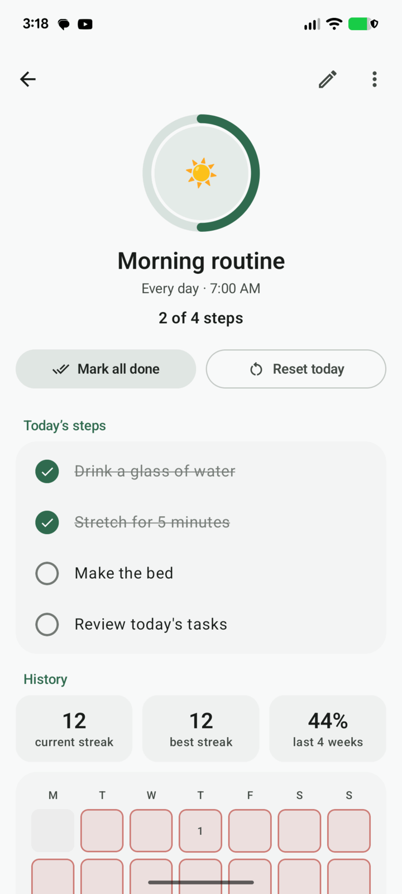 | 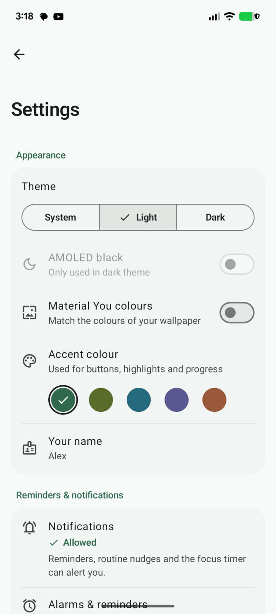 |
| **Dark** | **AMOLED black** | **Material You** | **Large text** |
|  | 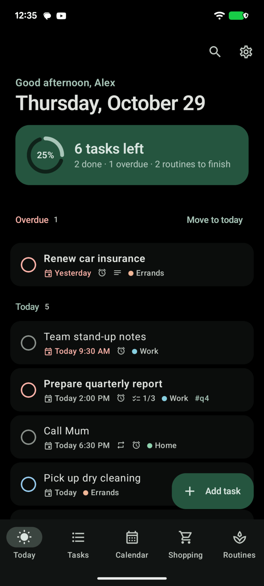 | 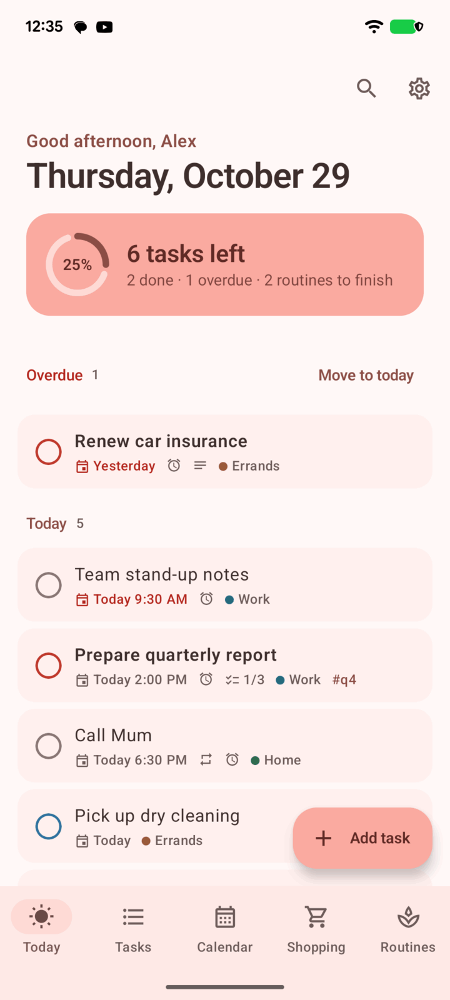 | 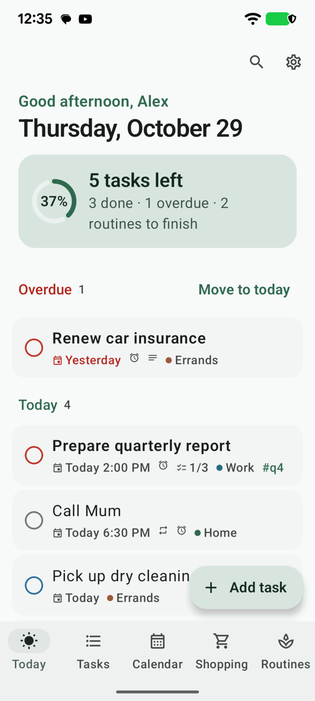 |
| **Settings (dark)** | **Calendar (dark)** | **Shopping (AMOLED)** | **Quick Add widget** |
| 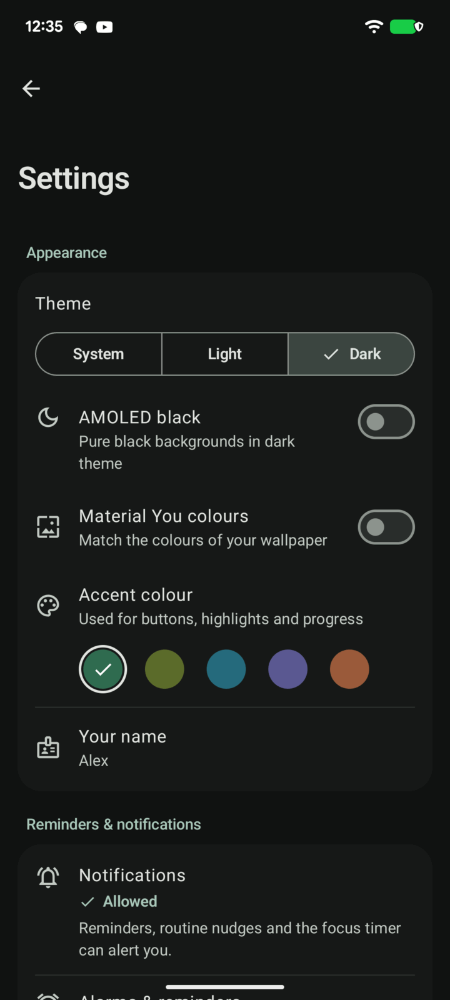 | 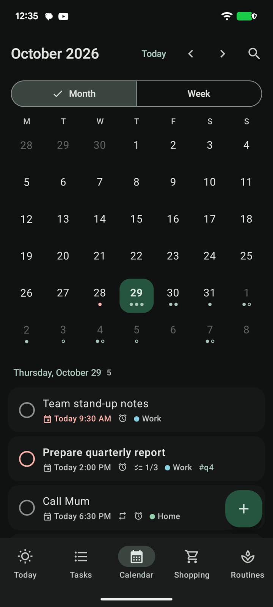 | 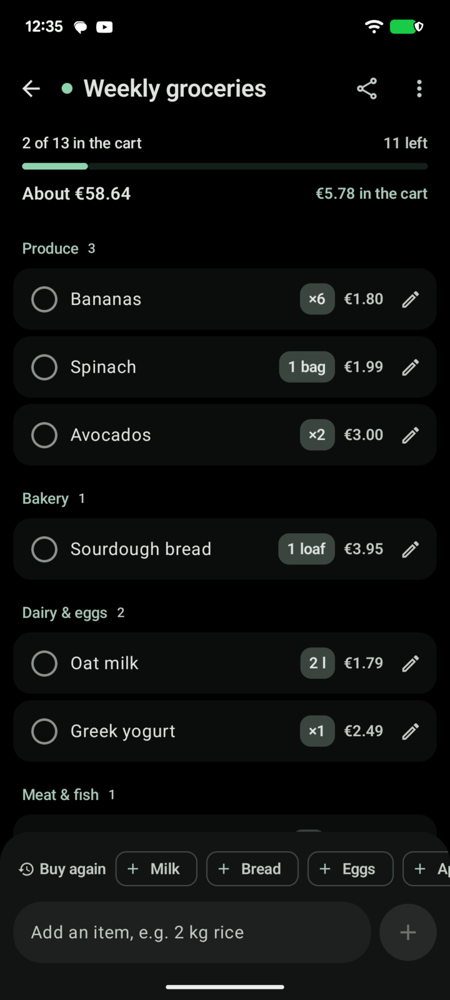 |  |

**Landscape** — a side navigation rail keeps the full height for content:

<p align="center">
  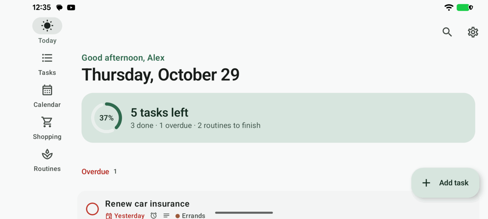
  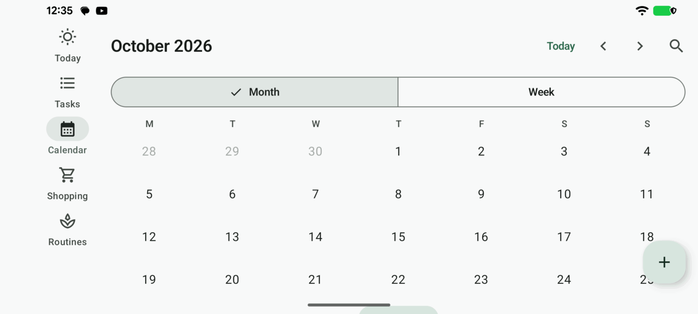
</p>

## Today dashboard

The Today screen shows your day at a glance: what is left, what is overdue, routines still to finish and the next
reminders. Complete a task with one tap (or a swipe), undo from the snackbar, swipe left to delete, long-press to
select several tasks and reschedule, re-prioritise, move or archive them together.

<p align="center">
  
  
</p>

## To-do list management

Create lists with colours and favourites, add notes, tags, priorities (none, low, medium, high) and checklists, pin
what matters, duplicate tasks and archive what you want out of sight. Deleted tasks go to **Recently deleted** and can
be restored until the trash is emptied (after 7, 30 or 90 days — your choice). Search covers titles, notes, tags and
checklist steps.

<p align="center">
  
  
  
</p>

## Reminders and recurring tasks

- Reminders at the due time or 10 minutes to 1 day before; tasks with only a date remind at your default time.
- Notification buttons: **Complete**, **Snooze 15 min** and **Tomorrow**.
- Exact alarms are used when you allow *Alarms & reminders*; otherwise Android may deliver a reminder a few minutes
  late, and Taskfern tells you so instead of pretending otherwise.
- Reminders are re-armed after a restart, an app update and a time or time-zone change; reminders missed while the
  phone was off are shown once it is back on (up to a day late).
- Repeating tasks are one task whose date moves forward; each finished occurrence is kept in Completed. Completing an
  overdue repeating task never leaves it overdue, and a quick double tap on a widget or notification can never complete
  the next occurrence by accident.

<p align="center">
  
  
</p>

## Shopping and groceries

Type “2 kg rice” or “eggs x12” in the bar at the bottom and keep typing — the keyboard stays open. Items land in the
right aisle, show quantities and optional prices, and move to “In the cart” with one tap. Taskfern remembers what you
buy for suggestions and **Buy again**, warns about duplicates, clears the cart with undo and shares the list as text.

<p align="center">
  
  
</p>

## Daily routines

Routines are reusable checklists — a morning start, an evening wind-down, a weekly reset. Choose the days, an optional
reminder time, then tick steps off each day. History shows the last weeks and your streak of fully completed days.

<p align="center">
  
  
</p>

## Interactive home-screen widgets

| Today's tasks | Shopping list | Weekly agenda | Daily routine |
| :---: | :---: | :---: | :---: |
| 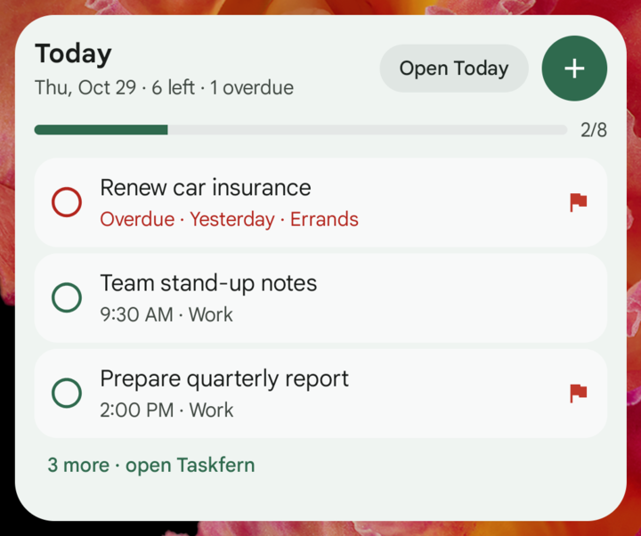 | 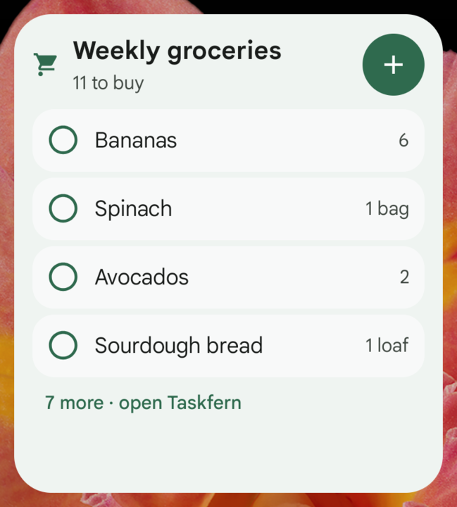 | 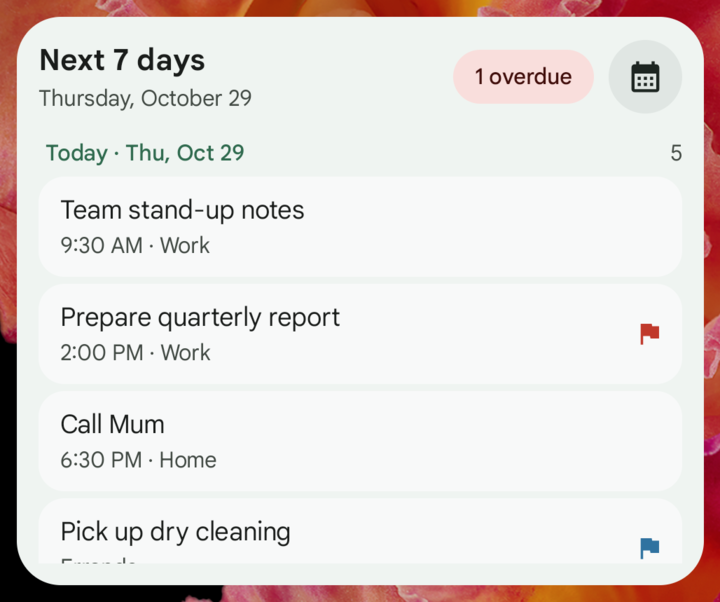 | 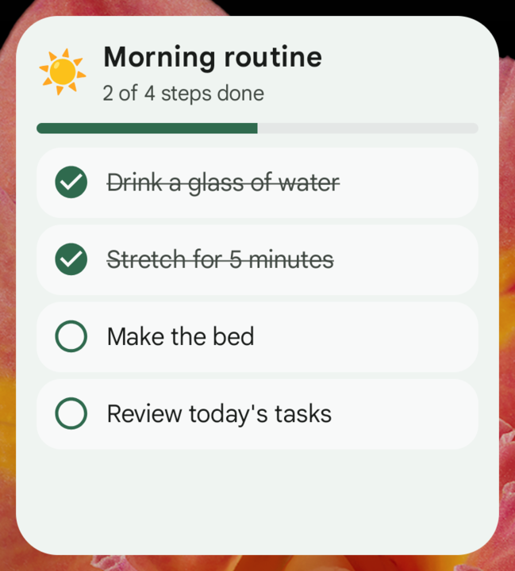 |

- **Today's tasks** — remaining count, progress and check-off buttons; adapts from a compact 2×2 to a large layout.
- **Quick Add** — a round button (or labelled pill) that opens the Quick Add sheet with your chosen list and due day.
- **Shopping list** — pick a list per widget; tick items off right on the home screen.
- **Weekly agenda** — the next 7 days grouped by date, with an overdue badge and an Open Calendar button.
- **Daily routine** — pick a routine per widget; tick off today's steps and watch the progress bar.

Widgets update the moment data changes — there is no polling. Add them from *Settings → Home-screen widgets* or by
long-pressing your home screen. Details: [docs/WIDGET_DESIGN.md](docs/WIDGET_DESIGN.md).

## Calendar and planning

Month and week views with due-task dots and outlined dots for upcoming repeats, a day list below the grid, long-press to
move a task to another day, and a + button that adds a task on the selected date. Export open dated tasks as an
`.ics` file to import into any calendar app.

<p align="center">
  
  
</p>

## Material You themes

Follow the system or force light or dark, turn on **AMOLED black** for OLED screens, use **Material You** colours from
your wallpaper (Android 12+) or pick one of five accent palettes: Fern, Moss, Ocean, Dusk and Clay.

<p align="center">
  
  
  
  
</p>

## Offline-first design

Taskfern stores everything in an on-device database and works the same in flight mode. There is no sync server and
no sign-in. The download is about 4 MB, and a cold start took about 0.2 s on the test Pixel 6.

## Privacy

- No account, no ads, no analytics, no crash reporting, no Google Play services or Firebase.
- **No `INTERNET` permission** — the build fails if any dependency tries to add one.
- Android cloud backup is disabled for Taskfern; your backups are files you choose where to keep.

See [PRIVACY.md](PRIVACY.md).

## Android compatibility

| | |
| --- | --- |
| Minimum | Android 8.0 (API 26) |
| Target | Android 17 (API 37) |
| Tested on | Google Pixel 6, Android 17 |
| Layouts | Phones in portrait and landscape (navigation rail on wide screens), large font sizes; wide-screen layouts are not yet tested on a physical tablet |

## Installation

Taskfern is distributed **only** through GitHub Releases.

1. On your Android phone open **https://github.com/riyadmondol2006/Taskfern/releases/latest**.
2. Download `Taskfern-vX.Y.Z-release.apk` from *Assets*.
3. Open the file. Android asks you to allow your browser or file manager to **install unknown apps** — this warning
   appears for every app installed outside an app store. Allow it for that app, then tap *Install*.
4. Open Taskfern. When you first set a reminder, allow notifications. For on-the-minute reminders, allow
   *Alarms & reminders* in *Settings → Reminders & notifications*.

Only download Taskfern from this repository. Copies from other sites may be modified.

### Verify the download (optional)

Each release lists the APK's SHA-256 checksum and includes a `.sha256` file:

```bash
sha256sum -c Taskfern-vX.Y.Z-release.apk.sha256
```

The release notes also show the SHA-256 fingerprint of the signing certificate; you can compare it with
`apksigner verify --print-certs Taskfern-vX.Y.Z-release.apk`.

## Updating the app

Download the newer APK from the latest release and install it over the existing app — your data stays. Android only
accepts an update signed with the **same key** as the installed app, so an update cannot be swapped for a tampered
copy. Taskfern does not update itself and never installs anything on its own. Before big changes (a new phone, a
factory reset) export a backup.

## Building from source

Requirements: JDK 21 and the Android SDK with platform 37.

```bash
git clone https://github.com/riyadmondol2006/Taskfern.git
cd Taskfern
./gradlew :app:assembleDebug           # app/build/outputs/apk/debug/app-debug.apk ("Taskfern Debug")
./gradlew :app:testDebugUnitTest       # unit tests
./gradlew :app:lintDebug               # Android Lint
./gradlew :app:connectedDebugAndroidTest   # instrumented tests on a connected device
```

Debug builds install next to the release app as `com.riyadmondol2006.taskfern.debug`.

## Project architecture

Kotlin, Jetpack Compose, Material 3, MVVM with `StateFlow`, Room, DataStore, WorkManager, AlarmManager, Glance for
widgets, kotlinx.serialization for backups and a small hand-written dependency container. Business rules (recurrence,
reminder maths, the Quick Add parser) are plain Kotlin with unit tests. Read [docs/ARCHITECTURE.md](docs/ARCHITECTURE.md),
the [implementation plan](docs/IMPLEMENTATION_PLAN.md) and the [product research](docs/PRODUCT_RESEARCH.md).

## GitHub Actions and releases

- [`release.yml`](.github/workflows/release.yml) — every push to `main` runs unit tests, Lint and builds, then signs,
  verifies and publishes a GitHub Release with the APK and its checksum.
- [`ci.yml`](.github/workflows/ci.yml) — pull requests and other branches: tests, Lint and builds, without secrets.

### Automatic versioning

| versionCode | versionName | Tag | APK |
| --- | --- | --- | --- |
| Release workflow run number | `1.0.<versionCode>` | `v1.0.<versionCode>` | `Taskfern-v1.0.<versionCode>-release.apk` |

Re-running a workflow produces the same version and does not publish twice; an old run re-run after a newer release
does not publish a downgrade; nothing is committed back to the repository. Local builds are `1.0.0-dev`. Full details:
[docs/RELEASING.md](docs/RELEASING.md).

### Signing configuration

Release APKs are signed in GitHub Actions with a key stored in four repository secrets (`SIGNING_KEYSTORE_BASE64`,
`SIGNING_STORE_PASSWORD`, `SIGNING_KEY_ALIAS`, `SIGNING_KEY_PASSWORD`). The workflow fails rather than publish an
unsigned or debug-signed APK, and it verifies the signature, application id and version before publishing.

## Backup and restore

*Settings → Backup & restore*:

- **Export backup** writes one JSON file (tasks, lists, shopping, routines, templates, focus history and settings) to
  a place you choose.
- **Restore** shows what the file contains, then **Merge** (adds what is new and skips what is already there) or
  **Replace** (after confirmation, makes this phone match the backup exactly).
- **Export to calendar (.ics)** for use in calendar apps.

Keep a recent backup somewhere safe: if you lose your phone, uninstall the app or move to a new phone, the backup is
how you get your data back.

## FAQ

**Is Taskfern really free?** Yes. No subscriptions, no ads, no paid tiers. It is MIT-licensed.

**Does it sync between devices?** No. Taskfern is deliberately offline. Use backup and restore to move data.

**Why isn't it on Google Play?** It is published on GitHub Releases, where every build is reproducible from the
public source and signed by the project.

**Why did a reminder arrive late?** Without *Alarms & reminders* permission, or with aggressive battery saving on some
phones, Android may delay alarms. See [Troubleshooting](#troubleshooting).

**What does “repeat after completion” mean?** The next date is counted from the day you finish the task (“water the
plants 3 days after I last did”), instead of a fixed schedule.

## Troubleshooting

- **No notifications** — allow notifications for Taskfern in Android settings; Today shows a banner when they are off.
- **Reminders a few minutes late** — allow *Alarms & reminders* (Settings → Reminders & notifications).
- **Reminders missing on some phones** — some manufacturers stop background apps; set Taskfern's battery usage to
  *Unrestricted* (Settings → Reminders & notifications → Battery). https://dontkillmyapp.com explains it per brand.
- **“App not installed” when updating** — the installed copy was signed with a different key (for example a debug or
  third-party build). Export a backup, uninstall it, install the official APK and restore.
- **A widget shows old data** — widgets refresh on every change; if a launcher was restarted, open Taskfern once.

## Contributing

Bug reports and ideas are welcome in [Issues](https://github.com/riyadmondol2006/Taskfern/issues). Read
[CONTRIBUTING.md](CONTRIBUTING.md) before opening a pull request. Security problems: see [SECURITY.md](SECURITY.md).

## License

Taskfern is released under the [MIT License](LICENSE). Copyright © 2026 riyadmondol2006.

## Credits

Built with Kotlin, Jetpack Compose, Material 3, Room, DataStore, WorkManager, Jetpack Glance and kotlinx libraries
(Apache License 2.0). The Taskfern name, logo and icon are original to this project. User needs were informed by the
sources in [docs/PRODUCT_RESEARCH.md](docs/PRODUCT_RESEARCH.md).

## Support

Questions, problems and suggestions: [open an issue on GitHub](https://github.com/riyadmondol2006/Taskfern/issues).
